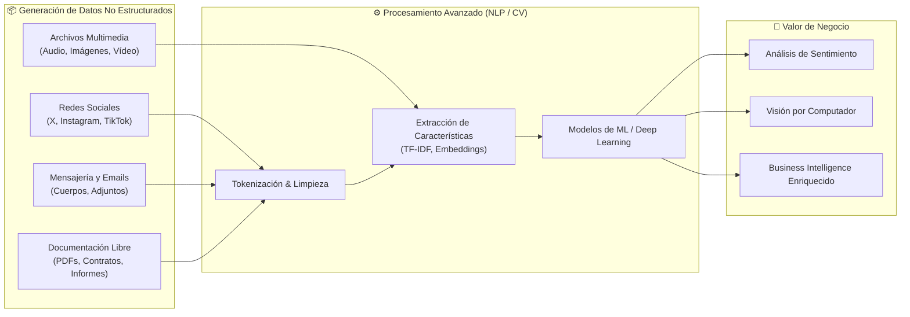
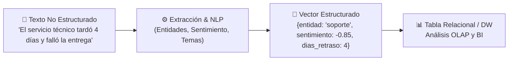
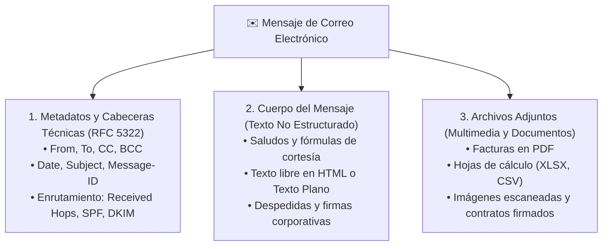
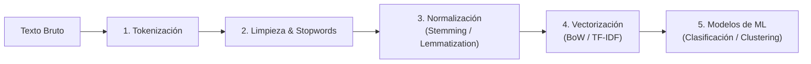
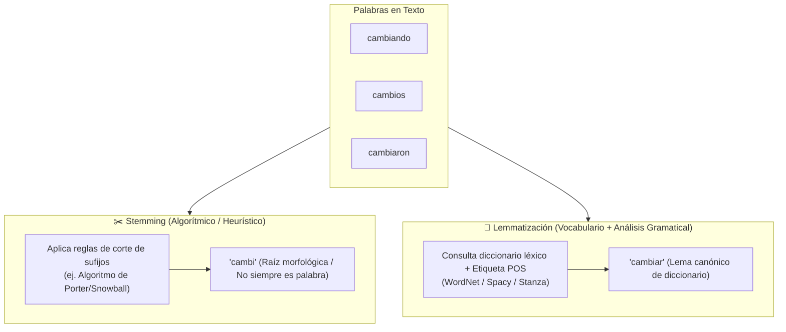
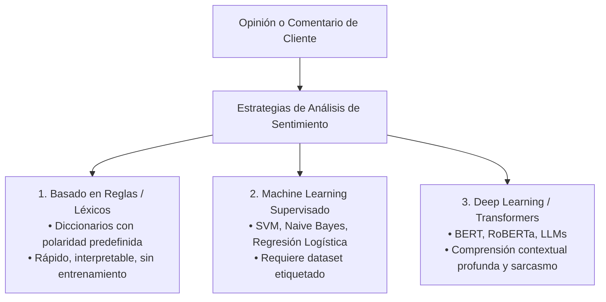

# Datos No Estructurados: Fuentes, Extracción y Procesamiento Avanzado

> Apuntes y conceptos teóricos de la asignatura **Big Data Aplicado**.  
> 📅 **Fecha:** 2026-10-14  
> 👨‍🏫 **Docentes:** Enrique y Ricardo  
> 📖 **Módulo:** Big Data Aplicado — Datos No Estructurados y Minería de Textos/Multimedia  

---

## 📑 Índice de Contenidos

1. [Introducción y Objetivos](#1-introducción-y-objetivos)
   - 1.1 [Contexto de la Sesión](#11-contexto-de-la-sesión)
   - 1.2 [Objetivos de Aprendizaje](#12-objetivos-de-aprendizaje)
   - 1.3 [Relevancia Estratégica de los Datos No Estructurados](#13-relevancia-estratégica-de-los-datos-no-estructurados)
2. [Taxonomía Comparativa: Estructurados vs. Semiestructurados vs. No Estructurados](#2-taxonomía-comparativa-estructurados-vs-semiestructurados-vs-no-estructurados)
   - 2.1 [Definiciones y Características Fundamentales](#21-definiciones-y-características-fundamentales)
   - 2.2 [Matriz Comparativa de Propiedades](#22-matriz-comparativa-de-propiedades)
   - 2.3 [Flujo de Transformación: De No Estructurado a Estructurado](#23-flujo-de-transformación-de-no-estructurado-a-estructurado)
3. [Fuentes Principales de Datos No Estructurados](#3-fuentes-principales-de-datos-no-estructurados)
   - 3.1 [Twitter (X): Microblogging y Flujos en Tiempo Real](#31-twitter-x-microblogging-y-flujos-en-tiempo-real)
   - 3.2 [Instagram: Contenido Visual y Multimodal](#32-instagram-contenido-visual-y-multimodal)
   - 3.3 [Correos Electrónicos: Estructura Híbrida y Riqueza Corporativa](#33-correos-electrónicos-estructura-híbrida-y-riqueza-corporativa)
   - 3.4 [Vídeos: La Dimensión Temporal en la Información Visual](#34-vídeos-la-dimensión-temporal-en-la-información-visual)
4. [Técnicas de Minería de Texto (Text Mining)](#4-técnicas-de-minería-de-texto-text-mining)
   - 4.1 [Pipeline de Preprocesamiento de Lenguaje Natural (NLP)](#41-pipeline-de-preprocesamiento-de-lenguaje-natural-nlp)
   - 4.2 [Stemming vs. Lemmatización](#42-stemming-vs-lemmatización)
   - 4.3 [Modelos de Representación Vectorial: Bag of Words (BoW)](#43-modelos-de-representación-vectorial-bag-of-words-bow)
   - 4.4 [Ponderación TF-IDF (Term Frequency - Inverse Document Frequency)](#44-ponderación-tf-idf-term-frequency---inverse-document-frequency)
   - 4.5 [Clasificación Supervisada de Documentos](#45-clasificación-supervisada-de-documentos)
5. [Análisis de Sentimientos (Sentiment Analysis & Opinion Mining)](#5-análisis-de-sentimientos-sentiment-analysis--opinion-mining)
   - 5.1 [Enfoques Metodológicos](#51-enfoques-metodológicos)
   - 5.2 [Análisis Basado en Aspectos (ABSA) y Detección de Emociones](#52-análisis-basado-en-aspectos-absa-y-detección-de-emociones)
6. [Implementación Práctica en Python](#6-implementación-práctica-en-python)
   - 6.1 [Preprocesamiento Textual y Comparativa Stemming vs. Lemmatización](#61-preprocesamiento-textual-y-comparativa-stemming-vs-lemmatización)
   - 6.2 [Vectorización TF-IDF y Matriz Término-Documento](#62-vectorización-tf-idf-y-matriz-término-documento)
   - 6.3 [Clasificador de Sentimiento con Naive Bayes](#63-clasificador-de-sentimiento-con-naive-bayes)
   - 6.4 [Extracción de Metadatos y Parseo de Correos Electrónicos (RFC 5322)](#64-extracción-de-metadatos-y-parseo-de-correos-electrónicos-rfc-5322)
7. [Desafíos, Ética y Gobernanza](#7-desafíos-ética-y-gobernanza)
   - 7.1 [Volumen, Velocidad y Cómputo Especializado](#71-volumen-velocidad-y-cómputo-especializado)
   - 7.2 [Privacidad, RGPD y Consideraciones Éticas](#72-privacidad-rgpd-y-consideraciones-éticas)
8. [Resumen de la Unidad, Conclusiones y Bibliografía](#8-resumen-de-la-unidad-conclusiones-y-bibliografía)
   - 8.1 [Conclusiones Principales](#81-conclusiones-principales)
   - 8.2 [Bibliografía y Recursos Recomendados](#82-bibliografía-y-recursos-recomendados)

---

## 1. Introducción y Objetivos

### 1.1 Contexto de la Sesión

En las primeras etapas de la informática empresarial, el almacenamiento y análisis de información se circunscribían casi en su totalidad a datos estructurados: tablas relacionales con esquemas fijos de columnas numéricas y de texto corto. Sin embargo, la revolución digital y la hiperconectividad han provocado un cambio radical de paradigma: se estima que entre el **80% y el 90%** de toda la información generada diariamente en el planeta corresponde a **datos no estructurados**.

Los datos no estructurados no encajan de forma nativa en un modelo relacional de filas y columnas. Abarcan desde conversaciones en redes sociales, transcripciones de atención al cliente y correos electrónicos corporativos, hasta imágenes médicas, señales acústicas y streams de vídeo de alta definición.



---

### 1.2 Objetivos de Aprendizaje

Al finalizar esta sesión, el alumnado será capaz de:
- **Comprender qué son los datos no estructurados** y distinguirlos con precisión de los formatos estructurados y semiestructurados.
- **Identificar y analizar las principales fuentes generadoras** de datos no estructurados (Twitter/X, Instagram, correo electrónico corporativo y flujos de vídeo).
- **Dominar el pipeline de minería de texto (*Text Mining*)**, comprendiendo el impacto de la tokenización, eliminación de *stop words*, *stemming*, lematización y representación vectorial mediante *Bag of Words* y *TF-IDF*.
- **Comprender los fundamentos del análisis de sentimientos (*Sentiment Analysis*)**, evaluando enfoques basados en reglas, aprendizaje automático supervisado y modelos profundos (*Transformers*).
- **Reconocer los desafíos computacionales, éticos y normativos** (RGPD, privacidad) asociados a la ingesta y explotación de este tipo de activos digitales.

---

### 1.3 Relevancia Estratégica de los Datos No Estructurados

La ventaja competitiva de las organizaciones modernas reside en su capacidad para transformar este océano de información caótica en conocimiento estructurado:
- **Voz del cliente (*Customer Voice*):** Permite medir la percepción pública en tiempo real sin encuestas tradicionales lentas y sesgadas.
- **Automatización de procesos cognitivos:** Clasificación inteligente de tickets de soporte, triaje de correos y análisis contractual.
- **Detección temprana de crisis y riesgos:** Monitorización de alertas operativas, anomalías en cámaras de seguridad o fugas de reputación corporativa.

---

## 2. Taxonomía Comparativa: Estructurados vs. Semiestructurados vs. No Estructurados

### 2.1 Definiciones y Características Fundamentales

1. **Datos Estructurados (*Structured Data*):**
   - **Formato:** Siguen un modelo formal estricto definido previamente (*Schema-on-Write*).
   - **Organización:** Matrices bidimensionales (tablas con columnas fuertemente tipadas y filas identificadas mediante claves primarias).
   - **Ejemplos:** Tablas en PostgreSQL, Oracle, MySQL, hojas de cálculo de Excel.
   - **Facilidad de consulta:** Muy alta mediante lenguajes declarativos como SQL.

2. **Datos Semiestructurados (*Semi-Structured Data*):**
   - **Formato:** No poseen una estructura tabular fija, pero contienen marcadores, etiquetas (*tags*) o claves jerárquicas autodescriptivas (*Schema-on-Read*).
   - **Organización:** Árboles de nodos, pares clave-valor y estructuras anidadas.
   - **Ejemplos:** Documentos JSON, XML, YAML, ficheros BSON en MongoDB.
   - **Facilidad de consulta:** Moderada; requiere operadores de acceso jerárquico (ej. JSONPath, XPath).

3. **Datos No Estructurados (*Unstructured Data*):**
   - **Formato:** Carecen de un esquema intrínseco o modelo predefinido.
   - **Organización:** Secuencias binarias continuas o cadenas libres de texto.
   - **Ejemplos:** Párrafos de texto libre, archivos PDF, audios WAV/MP3, imágenes JPG/PNG, vídeos MP4.
   - **Facilidad de consulta:** Nula mediante SQL clásico; requiere técnicas de Inteligencia Artificial (NLP, Visión Artificial, Reconocimiento del Habla).

---

### 2.2 Matriz Comparativa de Propiedades

| Criterio | Datos Estructurados | Datos Semiestructurados | Datos No Estructurados |
| :--- | :--- | :--- | :--- |
| **Esquema (*Schema*)** | Rígido en escritura (*Schema-on-Write*). | Flexible en lectura (*Schema-on-Read*). | Inexistente o implícito en el contenido. |
| **Modelo de Almacenamiento** | Bases de datos relacionales (RDBMS). | Bases NoSQL (Documentales, Clave-Valor). | Data Lakes (S3, HDFS), Object Storage, Blob Stores. |
| **Espacio de Almacenamiento** | Menor volumen global (~10-20% del total mundial). | Volumen intermedio. | Mayor volumen global (**~80-90% del total mundial**). |
| **Facilidad de Búsqueda** | Búsqueda indexada directa (B-Trees, Hash). | Búsqueda por clave/propiedad jerárquica. | Indexación invertida (OpenSearch), similitud vectorial (*Vector DB*). |
| **Tecnologías de Análisis** | SQL, Álgebra Relacional, BI estándar. | MapReduce, Spark DataFrames, XQuery. | NLP, Redes Neuronales Convolucionales (CNN), Transformers. |
| **Flexibilidad al Cambio** | Muy baja; alterar esquemas (*ALTER TABLE*) es costoso. | Alta; admite campos opcionales sin romper compatibilidad. | Máxima flexibilidad en ingesta; coste diferido al análisis. |

---

### 2.3 Flujo de Transformación: De No Estructurado a Estructurado

El cometido de las herramientas de Big Data e IA aplicadas consiste en transformar la masa de datos no estructurados en representaciones cuantitativas estructuradas que alimenten cuadros de mando y modelos de machine learning:



---

## 3. Fuentes Principales de Datos No Estructurados

### 3.1 Twitter (X): Microblogging y Flujos en Tiempo Real

Twitter (X) representa el paradigma de la información no estructurada en tiempo real debido a su alta velocidad y dispersión semántica:

- **Estructura del Tweet:** Textos breves (hasta 280 caracteres) enriquecidos con menciones (`@usuario`), hipervínculos y etiquetas temáticas (`#hashtag`).
- **Metadatos Vinculados:** Coordenadas GPS (opcionales), marca temporal UTC, identificador único de tweet, cliente de origen (*Sprinklr, Web App, iPhone*), número de *retweets*, citas, me gusta y perfil del emisor.
- **Desafíos Técnicos:**
  - *Lenguaje coloquial y ruidoso:* Uso extensivo de abreviaturas, erratas tipográficas intencionadas y emojis con carga polisémica.
  - *Sarcasmo e ironía:* La polaridad literal de las palabras contradice el sentido del mensaje.
  - *Velocidad e ingesta continua:* Picos de cientos de miles de tweets por segundo durante eventos masivos.
- **Oportunidades:**
  - Detección temprana de incidentes operativos (caídas de servicio eléctrico o telecomunicaciones).
  - Medición del impacto instantáneo de campañas publicitarias.

---

### 3.2 Instagram: Contenido Visual y Multimodal

Instagram se focaliza en el impacto gráfico y la interacción multimedia:

- **Componentes:**
  - *Fotografías y Vídeos:* Imágenes comprimidas con metadatos EXIF (modelo de cámara, apertura, resolución).
  - *Contenido Efímero (Stories):* Desaparición en 24 horas, lo que exige arquitecturas de ingesta en streaming que capturen la información antes de su purgado.
  - *Reels y Vídeos Verticales:* Fusión de imagen en movimiento, audio y efectos superpuestos.
  - *Pies de foto y comentarios:* Textos con alto porcentaje de hashtags de descubrimiento.
- **Desafíos:**
  - *Multimodalidad:* La intención real solo se comprende fusionando la información de la imagen con el texto del pie de foto.
  - *Coste computacional:* Procesar millones de imágenes requiere inferencia sobre tarjetas gráficas (GPU/TPU).
- **Oportunidades:**
  - Reconocimiento de marcas y productos en imágenes (*Visual Brand Intelligence*).
  - Análisis de tendencias de moda y comportamiento de consumo visual.

---

### 3.3 Correos Electrónicos: Estructura Híbrida y Riqueza Corporativa

El correo electrónico constituye el canal documental prioritario en el entorno corporativo. Presenta una arquitectura híbrida única:



- **Desafíos:**
  - Disparidad de estilos, idiomas y firmas que contaminan el análisis del cuerpo.
  - Necesidad de motores de OCR (*Optical Character Recognition*) para digitalizar adjuntos escaneados.
- **Oportunidades:**
  - Clasificación automática y enrutado de peticiones de clientes (*Helpdesk Automation*).
  - Detección de fugas de información confidencial (*Data Loss Prevention - DLP*) y ataques de *phishing*.

---

### 3.4 Vídeos: La Dimensión Temporal en la Información Visual

El vídeo representa el medio no estructurado más complejo y demandante de almacenamiento:
- **Componentes Fundamentales:**
  1. *Secuencia temporal de fotogramas:* Múltiples imágenes consecutivas (24 a 60 FPS) donde el movimiento relativo y la correlación inter-frame aportan información semántica crucial.
  2. *Pista de Audio:* Onda acústica que requiere procesamiento mediante modelos de *Speech-to-Text* (ej. OpenAI Whisper).
  3. *Subtítulos y Metadatos:* Pistas textuales sincronizadas (VTT, SRT) y metadatos del códec (H.264, AV1, MP4).
- **Casos de Uso:**
  - Analítica en tiendas físicas (*Retail Analytics*): mapas de calor de tránsito de clientes y tiempos de permanencia ante escaparates.
  - Videovigilancia y seguridad: detección en tiempo real de accesos indebidos o vehículos no autorizados.

---

## 4. Técnicas de Minería de Texto (Text Mining)

La **Minería de Texto** integra técnicas de lingüística computacional, estadística y aprendizaje automático para convertir colecciones textuales no estructuradas en datos estructurados numéricos susceptibles de análisis.



---

### 4.1 Pipeline de Preprocesamiento de Lenguaje Natural (NLP)

1. **Tokenización (*Tokenization*):**
   - División de una cadena continua de caracteres en unidades mínimas con significado léxico denominadas **tokens** (palabras, signos o n-gramas).
2. **Normalización y Limpieza:**
   - Conversión a minúsculas (*case folding*).
   - Eliminación de signos de puntuación, URLs, caracteres de control y números irrelevantes.
3. **Eliminación de Palabras Vacías (*Stop Words*):**
   - Supresión de términos altamente frecuentes que actúan como conectores gramaticales pero carecen de carga semántica discriminativa (artículos, preposiciones, pronombres: *el, la, de, en, y, que*).

---

### 4.2 Stemming vs. Lemmatización

Ambas técnicas persiguen reducir las distintas variantes flexivas de una palabra a una forma común, pero mediante métodos radicalmente diferentes:



| Característica | Stemming | Lemmatización |
| :--- | :--- | :--- |
| **Metodología** | Reglas heurísticas de recorte de sufijos (algoritmos Porter o Snowball). | Análisis morfológico completo apoyado en diccionarios y análisis sintáctico (*Part-of-Speech - POS tagging*). |
| **Resultado** | Raíz truncada (*stem*), que puede no existir en el idioma (ej. `comput` de *computadora* y *computación*). | Lema canónico formal presente en el diccionario (ej. `ir` a partir de *fui, iba, yendo*). |
| **Coste Computacional** | Muy bajo y extremadamente rápido; ideal para grandes motores de búsqueda. | Elevado; requiere lookup en bases léxicas y desambiguación contextual. |
| **Precisión** | Moderada; propenso a sobre-corte (*over-stemming*) o sub-corte (*under-stemming*). | Alta y semánticamente exacta. |

---

### 4.3 Modelos de Representación Vectorial: Bag of Words (BoW)

El modelo de **Bolsa de Palabras** (*Bag of Words*) transforma cada documento en un vector numérico cuya longitud coincide con el tamaño del vocabulario total del corpus:
- **Principio:** Se ignora el orden gramatical y la sintaxis; únicamente se computa la frecuencia de aparición de cada término en el documento.
- **Limitación:** Genera matrices con alta dispersión (*sparse matrices*) con miles de ceros y otorga peso excesivo a palabras muy repetitivas.

---

### 4.4 Ponderación TF-IDF (Term Frequency - Inverse Document Frequency)

**TF-IDF** es una técnica estadística que evalúa la relevancia de una palabra en un documento concreto en relación con una colección completa de documentos (*corpus*):

$$\text{TF-IDF}(t, d, D) = \text{TF}(t, d) \times \text{IDF}(t, D)$$

1. **Frecuencia del Término ($\text{TF}$):** Frecuencia con la que el término $t$ aparece en el documento $d$:
   $$\text{TF}(t, d) = \frac{f_{t, d}}{\sum_{t' \in d} f_{t', d}}$$

2. **Frecuencia Inversa de Documento ($\text{IDF}$):** Medida de la exclusividad o especificidad del término a lo largo de todo el corpus $D$ ($N = |D|$ número total de documentos):
   $$\text{IDF}(t, D) = \ln\left(\frac{1 + N}{1 + |\{d \in D : t \in d\}|}\right) + 1$$

> 📌 **Intuición Matemática:**
> - Si una palabra aparece muchas veces en un único documento pero en casi ningún otro del corpus (ej. "paralelización"), su valor TF-IDF será **muy alto**.
> - Si una palabra aparece en todos los documentos del corpus (ej. "empresa"), su valor IDF tenderá a cero, neutralizando su relevancia analítica.

---

### 4.5 Clasificación Supervisada de Documentos

Una vez vectorizado el texto mediante TF-IDF, los vectores numéricos se introducen en algoritmos de clasificación supervisada:
- **Naive Bayes Multinomial:** Basado en el Teorema de Bayes asumiendo independencia condicional entre palabras; extraordinariamente rápido y eficaz para detección de spam.
- **Support Vector Machines (SVM):** Busca el hiperplano óptimo de máxima separación en espacios vectoriales de alta dimensión; estándar de referencia para categorización temática.

---

## 5. Análisis de Sentimientos (Sentiment Analysis & Opinion Mining)

El **Análisis de Sentimientos** aplica procesamiento del lenguaje natural y aprendizaje automático para inferir la polaridad subjetiva, actitud o emoción contenida en un texto.



---

### 5.1 Enfoques Metodológicos

1. **Análisis Basado en Reglas y Léxicos (*Lexicon-Based*):**
   - Utiliza diccionarios anotados (ej. VADER, SentiWordNet) donde cada palabra tiene asignado un valor numérico de polaridad (ej. *excelente* = +3.0, *pésimo* = -3.0).
   - Aplica reglas para intensificadores ("muy bueno") y negaciones ("no es bueno").
   - *Ventaja:* No precisa fase previa de entrenamiento.
   - *Desventaja:* Falla ante ambigüedades idiomáticas, dobles sentidos y contextos técnicos.

2. **Aprendizaje Automático Supervisado (*Supervised ML*):**
   - Se entrena sobre miles de ejemplos previamente calificados manualmente (*Positivo, Neutro, Negativo*).
   - Modela combinaciones complejas de n-gramas.
   - *Desventaja:* Requiere un esfuerzo humano notable para la anotación del dataset.

3. **Aprendizaje Profundo y Modelos de Lenguaje (*Deep Learning & Transformers*):**
   - Empleo de redes neuronales preentrenadas con mecanismos de autoatención (*Self-Attention*) como BERT.
   - Capaces de interpretar el orden contextual bidireccional y detectar matices sutiles como el sarcasmo.
   - *Desventaja:* Elevado coste de cómputo en inferencia y memoria GPU.

---

### 5.2 Análisis Basado en Aspectos (ABSA) y Detección de Emociones

- **ABSA (*Aspect-Based Sentiment Analysis*):** En lugar de asignar una polaridad global única a una reseña, evalúa el sentimiento desglosado por cada componente del producto o servicio.
  > *Ejemplo:* "La comida del restaurante era deliciosa (+), pero el camarero fue muy lento y maleducado (-)".
- **Clasificación Multiclase de Emociones:** Trasciende la polaridad binaria (*positivo/negativo*) para categorizar estados afectivos: *Alegría, Ira, Tristeza, Miedo, Sorpresa, Disgusto*.

---

## 6. Implementación Práctica en Python

Todos los ejemplos se desarrollan en Python estándar empleando librerías especializadas del ecosistema de ciencia de datos (`nltk`, `scikit-learn`, `pandas`).

### 6.1 Preprocesamiento Textual y Comparativa Stemming vs. Lemmatización

El siguiente script ilustra el pipeline completo de limpieza, tokenización y la diferencia sustancial entre recortar sufijos (*Stemming*) y extraer el lema canónico (*Lemmatization*):

```python
import re
import nltk
from nltk.corpus import stopwords
from nltk.stem import SnowballStemmer
from nltk.stem import WordNetLemmatizer

# Descarga de recursos léxicos si no están presentes
nltk.download('stopwords', quiet=True)
nltk.download('wordnet', quiet=True)

def demo_preprocesamiento_nlp():
    texto_ejemplo = "Los ingenieros estaban programando y mejoraron rápidamente los sistemas distribuidos."
    
    # 1. Normalización y limpieza con expresiones regulares
    texto_limpio = re.sub(r'[^a-zA-ZáéíóúÁÉÍÓÚñÑ\s]', '', texto_ejemplo.lower())
    tokens = texto_limpio.split()
    
    # 2. Eliminación de Stop Words en español
    stop_words_es = set(stopwords.words('spanish'))
    tokens_filtrados = [palabra for palabra in tokens if palabra not in stop_words_es]
    
    # 3. Comparativa: Stemmer de Snowball vs Lematizador
    stemmer_es = SnowballStemmer('spanish')
    
    # Para la lematización en inglés/español ilustramos con palabras estándar
    palabras_test = ["programando", "mejoraron", "sistemas", "estudiando", "cambios"]
    
    print("--- PREPROCESAMIENTO Y FILTRADO DE STOP WORDS ---")
    print(f"Texto original:    '{texto_ejemplo}'")
    print(f"Tokens filtrados:  {tokens_filtrados}\n")
    
    print("--- COMPARATIVA DE STEMMING (SNOWBALL ESPAÑOL) ---")
    for palabra in palabras_test:
        stem = stemmer_es.stem(palabra)
        print(f"Palabra: {palabra:<15} -> Stem (Raíz): {stem}")

if __name__ == "__main__":
    demo_preprocesamiento_nlp()
```

---

### 6.2 Vectorización TF-IDF y Matriz Término-Documento

Transformación de un corpus de reseñas textuales en una matriz numérica ponderada mediante `TfidfVectorizer` de scikit-learn:

```python
import pandas as pd
from sklearn.feature_extraction.text import TfidfVectorizer

def demo_vectorizacion_tfidf():
    corpus = [
        "El servicio de almacenamiento en la nube es rápido y seguro",
        "La base de datos relacional almacena transacciones estructuradas",
        "El almacenamiento masivo y los sistemas distribuidos procesan petabytes en la nube",
        "El servicio al cliente resolvió el problema de almacenamiento rápidamente"
    ]

    vectorizador = TfidfVectorizer(stop_words=['el', 'la', 'en', 'es', 'y', 'los', 'de', 'al'])
    matriz_tfidf = vectorizador.fit_transform(corpus)
    
    # Conversión a DataFrame para inspección estructurada
    vocabulario = vectorizador.get_feature_names_out()
    df_tfidf = pd.DataFrame(matriz_tfidf.toarray(), columns=vocabulario)
    
    print("--- MATRIZ TÉRMINO-DOCUMENTO PONDERADA (TF-IDF) ---")
    print(df_tfidf[["almacenamiento", "nube", "servicio", "distribuidos", "estructuradas"]].round(3))

if __name__ == "__main__":
    demo_vectorizacion_tfidf()
```

---

### 6.3 Clasificador de Sentimiento con Naive Bayes

Construcción y evaluación de un pipeline completo de clasificación de opiniones en streaming (*Positivo* vs. *Negativo*):

```python
from sklearn.feature_extraction.text import TfidfVectorizer
from sklearn.naive_bayes import MultinomialNB
from sklearn.pipeline import Pipeline
from sklearn.metrics import classification_report

def entrenar_clasificador_sentimiento():
    # Dataset sintético de entrenamiento
    mensajes_train = [
        "Excelente servicio, la entrega fue inmediata y el producto perfecto",
        "Increíble calidad, volveré a comprar sin dudarlo, gran experiencia",
        "Totalmente satisfecho con el rendimiento del sistema, muy recomendado",
        "Pésima atención, el paquete llegó roto y nadie responde al teléfono",
        "Un desastre total, llevo esperando tres semanas y no llega el pedido",
        "Muy mala calidad, se estropeó al segundo día de uso, no lo recomiendo"
    ]
    etiquetas_train = ["positivo", "positivo", "positivo", "negativo", "negativo", "negativo"]

    # Definición de pipeline unificado (Vectorización + Clasificador Bayesiano)
    modelo_pipeline = Pipeline([
        ('tfidf', TfidfVectorizer()),
        ('clf', MultinomialNB())
    ])

    # Entrenamiento
    modelo_pipeline.fit(mensajes_train, etiquetas_train)

    # Inferencia sobre nuevos comentarios en tiempo real
    nuevos_comentarios = [
        "El paquete llegó a tiempo y funciona estupendamente",
        "Horrible soporte al cliente, una pérdida de dinero absoluta",
        "Rápido, eficiente y muy satisfecho con la compra"
    ]

    predicciones = modelo_pipeline.predict(nuevos_comentarios)
    probabilidades = modelo_pipeline.predict_proba(nuevos_comentarios)

    print("--- INFERENCIA DEL CLASIFICADOR DE SENTIMIENTO ---")
    for texto, pred, prob in zip(nuevos_comentarios, predicciones, probabilidades):
        confianza = max(prob) * 100
        print(f"Texto: '{texto}'")
        print(f" -> Sentimiento Predicho: [{pred.upper()}] (Confianza: {confianza:.1f}%)\n")

if __name__ == "__main__":
    entrenar_clasificador_sentimiento()
```

---

### 6.4 Extracción de Metadatos y Parseo de Correos Electrónicos (RFC 5322)

Extracción automatizada de metadatos de cabecera y separación del cuerpo libre y archivos adjuntos mediante la librería estándar `email` de Python:

```python
import email
from email import policy
from email.parser import BytesParser

def parsear_correo_electronico():
    # Mensaje simulado en formato MIME RFC 5322 estándar
    raw_email = b"""From: cliente.corporativo@empresa.com
To: soporte-bigdata@plataforma.io
Subject: Urgente: Incidencia en ingesta de datos Kafka
Date: Wed, 14 Oct 2026 19:45:00 +0200
Message-ID: <incidencia-20261014@empresa.com>
Content-Type: text/plain; charset="utf-8"

Estimado equipo de soporte,
Hemos detectado que el consumidor del topic de transacciones financieras
ha acumulado un consumer lag superior a 150.000 mensajes durante la ultima hora.
Rogamos revision inmediata de la arquitectura.

Atentamente,
Direccion de Operaciones IT
"""
    # Parseo estricto del estándar de Internet
    msg = BytesParser(policy=policy.default).parsebytes(raw_email)

    print("--- EXTRACCIÓN DE METADATOS Y CUERPO (PARSEO RFC 5322) ---")
    print(f"Remitente (From):    {msg['from']}")
    print(f"Destinatario (To):   {msg['to']}")
    print(f"Asunto (Subject):    {msg['subject']}")
    print(f"Fecha de Envío:      {msg['date']}")
    print(f"ID del Mensaje:      {msg['message-id']}")
    print("\n--- CONTENIDO NO ESTRUCTURADO (CUERPO) ---")
    print(msg.get_body(preferencelist=('plain')).get_content().strip())

if __name__ == "__main__":
    parsear_correo_electronico()
```

---

## 7. Desafíos, Ética y Gobernanza

### 7.1 Volumen, Velocidad y Cómputo Especializado

- **Desbordamiento de Infraestructura:** El ritmo de creación de ficheros de vídeo y logs no estructurados satura rápidamente los discos convencionales, obligando a emplear Data Lakes escalables y políticas agresivas de retención y ciclo de vida (*Lifecycle Management* hacia niveles *Glacier/Deep Archive*).
- **Necesidad de Aceleración por Hardware:** Los algoritmos de aprendizaje profundo aplicados al análisis de imagen, vídeo y modelos LLM no son viables sobre CPUs clásicas; demandan clústeres de GPUs dedicadas (NVIDIA A100/H100) y frameworks optimizados (TensorRT, ONNX).

---

### 7.2 Privacidad, RGPD y Consideraciones Éticas

- **Datos Personales Ocultos:** Los textos libres y las grabaciones audiovisuales con frecuencia contienen información confidencial (números de tarjeta bancaria, historiales de salud, datos biométricos o identificadores fiscales) no catalogados formalmente.
- **Anonimización y Enmascaramiento:** Obligación legal de aplicar pipelines de *Named Entity Recognition* (NER) para detectar y ofuscar automáticamente cualquier dato personal identificado antes de transferirlo al Data Lake.
- **Sesgo Algorítmico y Discriminación:** Los modelos de análisis de sentimientos entrenados sobre redes sociales heredan sesgos culturales, estereotipos y prejuicios lingüísticos presentes en el corpus original.

---

## 8. Resumen de la Unidad, Conclusiones y Bibliografía

### 8.1 Conclusiones Principales

1. **Predominio cuantitativo del dato no estructurado:** Más del 80% de la información corporativa no reside en bases de datos relacionales; su explotación es imprescindible para la toma de decisiones informadas.
2. **El preprocesamiento es el 80% del esfuerzo:** La calidad final de cualquier clasificador o modelo analítico depende críticamente de la rigurosidad en las fases de tokenización, limpieza, filtrado de stopwords y normalización léxica (*stemming/lematización*).
3. **Ponderación ponderada TF-IDF:** Permite discriminar el ruido comunicativo común y destacar los términos verdaderamente diferenciadores de cada documento.
4. **Enfoques híbridos en sentimiento:** La integración de reglas léxicas con modelos de Machine Learning y Transformers ofrece el mejor balance entre interpretabilidad y precisión contextual.
5. **Gobernanza y Privacidad:** La ingesta y almacenamiento de textos libres y contenidos multimedia exige protocolos estrictos de anonimización y cumplimiento del marco legal de protección de datos (RGPD).

---

### 8.2 Bibliografía y Recursos Recomendados

- **Liu, Bing (2015).** *Sentiment Analysis: Mining Opinions, Sentiments, and Emotions*. Cambridge University Press.  
  > 💡 Tratado exhaustivo sobre minería de opinión, análisis de sentimientos basado en aspectos y detección de reseñas falsas (*opinion spam*).
- **Brownlee, Jason (2017).** *Deep Learning for Natural Language Processing: Develop Deep Learning Models for your Natural Language Problems*. Machine Learning Mastery.  
  > 💡 Guía práctica paso a paso para la implementación de Bag of Words, Word Embeddings y modelos neuronales en Python.
- **Bird, Steven; Klein, Ewan & Loper, Edward (2009).** *Natural Language Processing with Python: Analyzing Text with the Natural Language Toolkit*. O'Reilly Media.  
  > 💡 Manual de referencia para el uso de la librería NLTK en tareas de tokenización, etiquetado POS y extracción morfológica.
- **Portales y Recursos en Línea:**
  - *OpenCV (Open Source Computer Vision Library)*: Documentación y tutoriales para el tratamiento avanzado de imágenes y vídeo.
  - *Hugging Face Transformers Documentation*: Repositorio de referencia para el despliegue de modelos profundos de NLP y análisis de sentimiento.

