# Sistemas de Gestión del Almacenamiento: Ingesta de Datos

> Apuntes y conceptos teóricos de la asignatura **Big Data Aplicado**.  
> 📅 **Fecha:** 2026-10-14  
> 👨‍🏫 **Docentes:** Enrique y Ricardo  
> 📖 **Módulo:** Big Data Aplicado — Ingesta y Gestión del Almacenamiento  

---

## 📑 Índice de Contenidos

1. [Introducción y Objetivos](#1-introducción-y-objetivos)
   - 1.1 [Contexto de la Sesión](#11-contexto-de-la-sesión)
   - 1.2 [Objetivos de Aprendizaje](#12-objetivos-de-aprendizaje)
   - 1.3 [El Rol Crítico de la Ingesta en el Ciclo de Vida del Dato](#13-el-rol-crítico-de-la-ingesta-en-el-ciclo-de-vida-del-dato)
2. [Tipos y Métodos de Ingesta de Datos](#2-tipos-y-métodos-de-ingesta-de-datos)
   - 2.1 [Ingesta por Lotes (Batch Processing)](#21-ingesta-por-lotes-batch-processing)
   - 2.2 [Ingesta en Tiempo Real (Stream Processing)](#22-ingesta-en-tiempo-real-stream-processing)
   - 2.3 [Ingesta en Micro-Lotes (Micro-Batch)](#23-ingesta-en-micro-lotes-micro-batch)
   - 2.4 [Comparativa Exhaustiva: Batch vs. Micro-Batch vs. Streaming](#24-comparativa-exhaustiva-batch-vs-micro-batch-vs-streaming)
3. [Fuentes de Datos y Sistemas de Mensajería](#3-fuentes-de-datos-y-sistemas-de-mensajería)
   - 3.1 [Sensores y Dispositivos IoT](#31-sensores-y-dispositivos-iot)
   - 3.2 [Redes Sociales y Contenido Web](#32-redes-sociales-y-contenido-web)
   - 3.3 [Sistemas de Mensajería y Colas (Message Queues)](#33-sistemas-de-mensajería-y-colas-message-queues)
4. [Conceptos Relacionados y Mejores Prácticas en Ingesta](#4-conceptos-relacionados-y-mejores-prácticas-en-ingesta)
   - 4.1 [Diseño para la Escalabilidad Horizontal (Scale-Out)](#41-diseño-para-la-escalabilidad-horizontal-scale-out)
   - 4.2 [Validación Temprana y Calidad del Dato (Shift-Left Quality)](#42-validación-temprana-y-calidad-del-dato-shift-left-quality)
   - 4.3 [Formatos de Serialización Eficientes: Parquet vs. Avro](#43-formatos-de-serialización-eficientes-parquet-vs-avro)
   - 4.4 [Optimización mediante Compresión](#44-optimización-mediante-compresión)
   - 4.5 [Monitoreo, Alertas y Linaje del Dato](#45-monitoreo-alertas-y-linaje-del-dato)
5. [Caso de Uso: Ingesta en Plataforma de E-Commerce a Gran Escala](#5-caso-de-uso-ingesta-en-plataforma-de-e-commerce-a-gran-escala)
   - 5.1 [Escenario y Desafíos de Negocio](#51-escenario-y-desafíos-de-negocio)
   - 5.2 [Diseño de la Solución Híbrida](#52-diseño-de-la-solución-híbrida)
   - 5.3 [Implementación Práctica en Python](#53-implementación-práctica-en-python)
6. [Arquitecturas Cloud Escalables de Ingesta (Referencia AWS)](#6-arquitecturas-cloud-escalables-de-ingesta-referencia-aws)
   - 6.1 [Desglose por Capas y Servicios AWS](#61-desglose-por-capas-y-servicios-aws)
   - 6.2 [Justificación de los Componentes Arquitectónicos](#62-justificación-de-los-componentes-arquitectónicos)
7. [Resumen de la Unidad, Conclusiones y Bibliografía](#7-resumen-de-la-unidad-conclusiones-y-bibliografía)
   - 7.1 [Conclusiones Principales](#71-conclusiones-principales)
   - 7.2 [Bibliografía y Recursos Recomendados](#72-bibliografía-y-recursos-recomendados)

---

## 1. Introducción y Objetivos

### 1.1 Contexto de la Sesión

En los ecosistemas contemporáneos de Big Data, la ingesta representa la primera frontera funcional. Ningún análisis avanzado, entrenamiento de modelos de Machine Learning o panel de control ejecutivo (*dashboard*) es posible sin un mecanismo robusto, tolerante a fallos y elástico que capture los datos desde sus puntos de emisión originales y los transporte de manera íntegra hacia las capas de almacenamiento y procesamiento.

La ingesta de datos no es una simple operación de copia de ficheros; implica la adquisición, transporte, validación preliminar, enrutamiento y entrega de flujos masivos de eventos heterogéneos generados por aplicaciones web, sensores conectados, transacciones financieras y colas de mensajería.

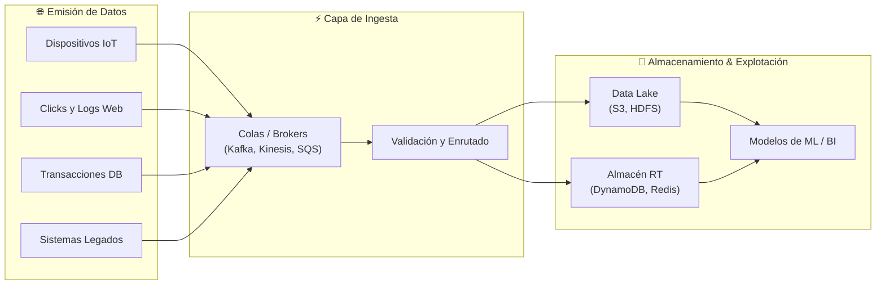

---

### 1.2 Objetivos de Aprendizaje

Al completar esta unidad didáctica, el alumnado será capaz de:
- **Comprender el concepto de ingesta de datos** y su posición estratégica en las arquitecturas modernas de información.
- **Diferenciar y evaluar los tipos y métodos de ingesta**: *Batch* (por lotes), *Real-Time* (en tiempo real continuo) y *Micro-Batch* (micro-lotes).
- **Analizar la relevancia de la ingesta** para eliminar silos de información, garantizar consistencia y habilitar la analítica predictiva y operativa.
- **Identificar las principales fuentes de datos** (sensores IoT, feeds de redes sociales, estructuras de colas FIFO).
- **Aplicar mejores prácticas de ingeniería de datos**, tales como la adopción de formatos columnares y binarios (*Parquet*, *Avro*), validación temprana (*Shift-Left Data Quality*) y monitorización continua.
- **Diseñar e interpretar arquitecturas de ingesta escalables** tanto en entornos *on-premise* como en infraestructuras *Cloud* (AWS).

---

### 1.3 El Rol Crítico de la Ingesta en el Ciclo de Vida del Dato

La ingesta actúa como el punto de anclaje para la gobernanza y la gestión de la calidad. Una ingesta deficiente contamina las capas posteriores (el fenómeno del *Data Swamp* o pantano de datos), mientras que una ingesta controlada garantiza:

1. **Aceleración en la disponibilidad:** Reducción drástica del *Time-to-Value* desde que el evento ocurre hasta que se convierte en información procesable.
2. **Eliminación de silos organizativos:** Unificación de fuentes dispares en un repositorio accesible y unificado.
3. **Resiliencia ante el cambio:** Capacidad de absorber picos de carga imprevistos sin pérdida de información mediante desacoplamiento temporal.
4. **Gobierno y linaje:** Trazabilidad desde el primer milisegundo de vida de cada registro.

---

## 2. Tipos y Métodos de Ingesta de Datos

La elección del método de ingesta depende directamente del balance entre **latencia requerida**, **volumen de datos**, **coste operativo** y **complejidad arquitectónica**.

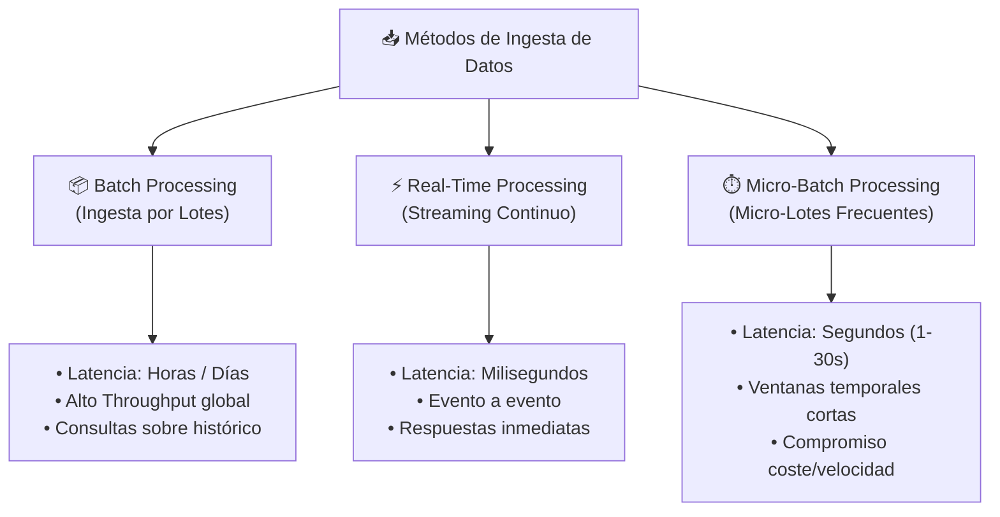

---

### 2.1 Ingesta por Lotes (Batch Processing)

#### Concepto y Funcionamiento
En la **ingesta por lotes**, los eventos y registros generados durante un intervalo de tiempo predefinido (ej. cada hora, al cierre de la jornada a las 23:59, o semanalmente) se acumulan de manera pasiva y se transfieren y procesan en bloque.

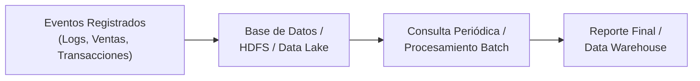

#### Ventajas
- **Eficiencia de recursos:** Maximiza el rendimiento de la CPU y la red al transferir y transformar grandes volúmenes en operaciones masivas continuas.
- **Simplicidad arquitectónica:** No requiere mantener conexiones persistentes ni infraestructuras distribuidas activas en baja demanda.
- **Facilidad de recuperación:** Si un lote falla a mitad de ejecución, puede reintentarse de forma íntegra (*idempotencia*).

#### Desventajas
- **Alta latencia temporal:** Los datos analizados representan una instantánea del pasado; no permite reaccionar ante contingencias inmediatas.
- **Picos de carga concentrados:** Sobrecarga puntual de la infraestructura durante la ventana de procesamiento (ej. a medianoche).

#### Implementación Práctica en Python: Ingesta Batch con Pandas y PySpark

A continuación se muestra un pipeline de ingesta batch que lee registros transaccionales acumulados, valida campos, agrega métricas por cliente y los persiste en formato particionado:

```python
import pandas as pd
from datetime import datetime

def simular_ingesta_batch():
    # 1. Simulación de registros acumulados durante una jornada comercial
    raw_data = [
        {"transaccion_id": 101, "cliente_id": "C001", "importe": 150.50, "fecha": "2026-10-14 08:30:15"},
        {"transaccion_id": 102, "cliente_id": "C002", "importe": 42.00,  "fecha": "2026-10-14 09:12:00"},
        {"transaccion_id": 103, "cliente_id": "C001", "importe": 89.90,  "fecha": "2026-10-14 14:45:22"},
        {"transaccion_id": 104, "cliente_id": "C003", "importe": 310.00, "fecha": "2026-10-14 18:20:10"},
        {"transaccion_id": 105, "cliente_id": "C002", "importe": 15.75,  "fecha": "2026-10-14 20:05:40"}
    ]
    
    # 2. Carga en DataFrame (Ingesta del Lote Diario)
    df_batch = pd.DataFrame(raw_data)
    df_batch["fecha"] = pd.to_datetime(df_batch["fecha"])
    
    # 3. Transformación Batch: Agregación de gasto y total transacciones
    resumen_diario = df_batch.groupby("cliente_id").agg(
        total_gastado=("importe", "sum"),
        num_operaciones=("transaccion_id", "count"),
        ticket_promedio=("importe", "mean")
    ).reset_index()
    
    # 4. Guardado en Data Lake / Almacén columnar
    print("--- RESUMEN BATCH DE CIERRE DE JORNADA (2026-10-14) ---")
    print(resumen_diario.to_string(index=False))

if __name__ == "__main__":
    simular_ingesta_batch()
```

---

### 2.2 Ingesta en Tiempo Real (Stream Processing)

#### Concepto y Funcionamiento
En la **ingesta en tiempo real** (*streaming*), cada evento individual es capturado, procesado y almacenado de manera inmediata conforme ocurre, con latencias que oscilan entre milisegundos y pocos segundos.

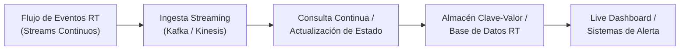

#### Ventajas
- **Latencia mínima:** Permite visibilidad en directo y respuesta automatizada ante fraudes, caídas de servicio o cambios bruscos en mercados financieros.
- **Flujo de carga constante:** La demanda de computación se distribuye homogéneamente a lo largo del tiempo, evitando picos masivos.

#### Desventajas
- **Mayor complejidad de ingeniería:** Requiere gestionar eventos desordenados (*out-of-order events*), marcas de tiempo (*watermarking*), y semánticas de entrega (*at-least-once*, *exactly-once*).
- **Coste computacional:** Los componentes deben estar siempre encendidos y activos (*always-on*), lo que incrementa el coste operativo.

#### Implementación Práctica en Python: Procesamiento Evento a Evento con Streaming Generator

```python
import time
import json
import random

def generador_eventos_sensor():
    """Simula una fuente continua de telemetría IoT."""
    sensores = ["TEMP_S01", "TEMP_S02", "PRES_S01"]
    for i in range(1, 6):
        evento = {
            "evento_id": f"evt_{i}",
            "sensor": random.choice(sensores),
            "valor": round(random.uniform(18.0, 45.0), 2),
            "timestamp": time.time()
        }
        yield json.dumps(evento)
        time.sleep(0.3)  # Intervalo de emisión en streaming

def procesador_streaming(stream):
    print("--- INICIANDO CONSUMO EN TIEMPO REAL ---")
    UMBRAL_ALERTA = 40.0
    
    for mensaje in stream:
        dato = json.loads(mensaje)
        sensor = dato["sensor"]
        valor = dato["valor"]
        
        # Procesamiento y detección inmediata de anomalías
        if valor > UMBRAL_ALERTA:
            print(f"🚨 [ALERTA INMEDIATA] {sensor} superó el umbral seguro: {valor} °C")
        else:
            print(f"✅ [NORMAL] Evento {dato['evento_id']} recibido: {sensor} = {valor} °C")

if __name__ == "__main__":
    stream_iot = generador_eventos_sensor()
    procesador_streaming(stream_iot)
```

---

### 2.3 Ingesta en Micro-Lotes (Micro-Batch)

#### Concepto y Características
La ingesta en **micro-lotes** representa un enfoque pragmático que tiende un puente entre el procesamiento por lotes tradicional y el streaming continuo puro. En lugar de procesar evento a evento o esperar horas a que se acumule un gran lote, el sistema empaqueta los eventos recibidos en ventanas temporales muy breves (típicamente entre 500 milisegundos y 30 segundos).

- **Mecanismo:** Herramientas como *Apache Spark Streaming* (motor original de DStreams y Structured Streaming con triggers basados en tiempo) consolidan las operaciones del micro-lote aplicando optimizaciones vectorizadas y tolerancia a fallos mediante RDDs o DataFrames distribuidos.
- **Ventajas:**
  - Alto rendimiento global (*throughput*) gracias al aprovechamiento del procesamiento vectorizado.
  - Reutilización directa del código y lógica analítica escrita para pipelines batch.
  - Tolerancia a fallos simple y robusta mediante recreación de particiones.
- **Desventajas:**
  - Introduce una latencia intrínseca mínima correspondiente a la duración del trigger del micro-batch (no aplicable a trading de alta frecuencia o sistemas críticos de sub-milisegundo).

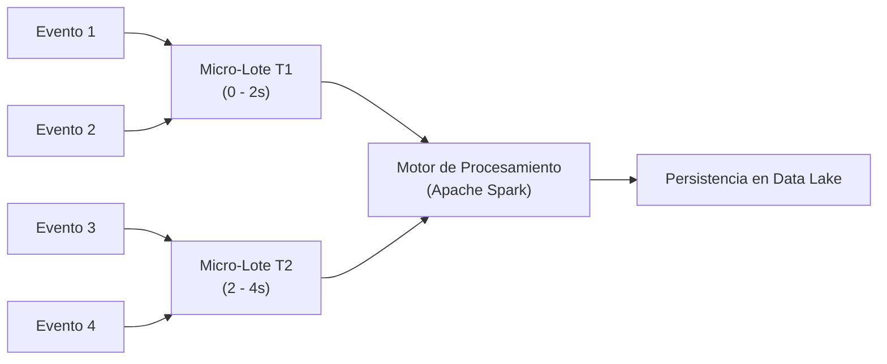

---

### 2.4 Comparativa Exhaustiva: Batch vs. Micro-Batch vs. Streaming

| Parámetro | Ingesta por Lotes (*Batch*) | Ingesta Micro-Batch | Ingesta Streaming Puro |
| :--- | :--- | :--- | :--- |
| **Unidad de Trabajo** | Archivos masivos / Bloques temporales extensos. | Colección de eventos en ventanas breves ($0.5s - 30s$). | Registro / Evento individual atómico. |
| **Latencia Típica** | Horas a días. | Segundos. | Milisegundos a subsegundo. |
| **Rendimiento (*Throughput*)** | Máximo por unidad de coste. | Alto y optimizado vectorialmente. | Variable; sensible a sobrecargas instantáneas. |
| **Complejidad de Gestión** | Baja a moderada; orquestado por cron / Airflow. | Moderada; sincronización por ventanas temporales. | Alta; requiere brokers de eventos y control de *backpressure*. |
| **Tolerancia a Fallos** | Reprocesamiento completo del lote. | Reprocesamiento de la ventana fallida. | Gestión de *offsets*, *checkpoints* y dead-letter queues. |
| **Tecnologías Representativas** | Apache Hadoop HDFS, AWS Glue Batch, dbt, Airflow. | Apache Spark Structured Streaming. | Apache Kafka, Apache Flink, AWS Kinesis, RabbitMQ. |

---

## 3. Fuentes de Datos y Sistemas de Mensajería

### 3.1 Sensores y Dispositivos IoT

El despliegue de sensores inteligentes, etiquetas RFID, contadores industriales y dispositivos médicos conectados genera flujos continuos de datos telemétricos con particularidades únicas:

- **Identificadores Únicos y Metadatos:** Direcciones MAC, identificadores RFID, ubicación geoespacial (latitud, longitud, altitud) y estado del hardware.
- **Variables Ambientales y Físicas:** Temperatura, presión barométrica, vibración mecánica, consumo energético y humedad.
- **Restricciones de Red:** Conectividad intermitente en el borde (*Edge*), consumo energético restringido y necesidad de protocolos ligeros como MQTT o CoAP.

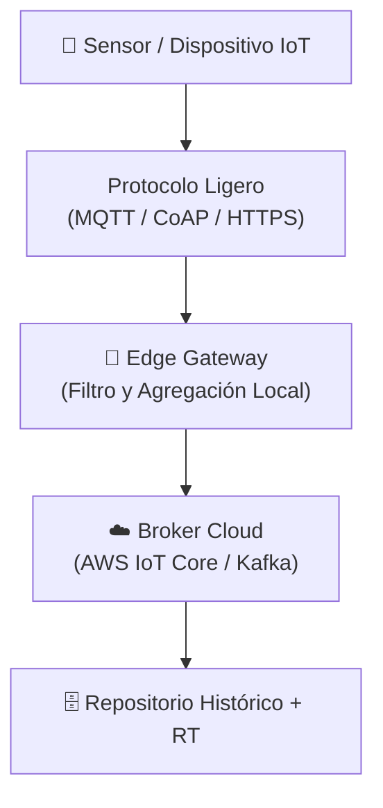

---

### 3.2 Redes Sociales y Contenido Web

Las fuentes web y redes sociales (X/Twitter, feeds RSS, portales de noticias, registros de interacción de usuarios) se caracterizan por su naturaleza semiestructurada o no estructurada:

- **Estructura Dinámica:** Formatos JSON enriquecidos que incluyen textos, menciones, enlaces, arrays de etiquetas (*hashtags*) y metadatos de autor.
- **Ingesta vía Webhooks y APIs:** Recepción pasiva orientada a eventos mediante webhooks HTTPS o ingesta activa mediante consultas periódicas a APIs REST respetando los límites de peticiones (*rate limits*).
- **Procesamiento de Texto:** Necesidad de preprocesado temprano (eliminación de caracteres no imprimibles, normalización Unicode, análisis de sentimiento preliminar).

---

### 3.3 Sistemas de Mensajería y Colas (Message Queues)

Los sistemas de mensajería representan la infraestructura de desacoplamiento por excelencia entre los sistemas generadores de datos (*Productores*) y los sistemas encargados del procesamiento y persistencia (*Consumidores*).

#### Principio Fundamental FIFO (First-In, First-Out)
Las colas de mensajes garantizan que los eventos se lean en el mismo orden de llegada:
- **Enqueue:** Operación de inserción por el extremo trasero (*Rear end*) controlada por el puntero de cola (*Rear pointer*).
- **Dequeue:** Operación de extracción por el extremo delantero (*Front end*) controlada por el puntero de cabeza (*Front pointer*).

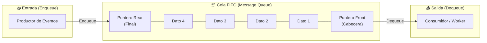

#### Ventajas del Desacoplamiento mediante Colas
1. **Amortiguación de Picos (*Buffer*):** Si un servicio web genera 50.000 peticiones por segundo durante una campaña y la base de datos sólo admite 5.000 escrituras concurrentes, la cola absorbe el exceso sin degradar el servicio.
2. **Desacoplamiento Temporal:** Los consumidores pueden detenerse por mantenimiento sin que los productores se vean interrumpidos.
3. **Escalabilidad Elástica:** Permite añadir múltiples consumidores en paralelo (*Consumer Groups*) para repartir la carga de lectura de particiones.

#### Implementación Práctica en Python: Cola FIFO con Control de Concurrencia y Buffer

```python
from collections import deque
import time

class ColaMensajeriaFIFO:
    def __init__(self, capacidad_maxima=5):
        self.cola = deque()
        self.capacidad_maxima = capacidad_maxima

    def enqueue(self, mensaje):
        """Añade un mensaje al final de la cola (Rear)."""
        if len(self.cola) >= self.capacidad_maxima:
            print(f"⚠️ [BACKPRESSURE] Cola llena ({len(self.cola)}/{self.capacidad_maxima}). Rechazando o pausando productor...")
            return False
        self.cola.append(mensaje)
        print(f"📥 [ENQUEUE] Mensaje '{mensaje['id']}' añadido en el Rear. Tamaño cola: {len(self.cola)}")
        return True

    def dequeue(self):
        """Extrae el mensaje más antiguo de la cabecera (Front)."""
        if not self.cola:
            print("📭 [COLA VACÍA] No hay mensajes pendientes.")
            return None
        mensaje = self.cola.popleft()
        print(f"📤 [DEQUEUE] Mensaje '{mensaje['id']}' consumido del Front.")
        return mensaje

# Demostración del funcionamiento FIFO
if __name__ == "__main__":
    broker = ColaMensajeriaFIFO(capacidad_maxima=3)
    
    # Productores encolando eventos
    broker.enqueue({"id": "MSG_001", "payload": "Login usuario A"})
    broker.enqueue({"id": "MSG_002", "payload": "Añadir al carrito producto X"})
    broker.enqueue({"id": "MSG_003", "payload": "Transacción checkout $50"})
    
    # Intento de desbordamiento (Backpressure)
    broker.enqueue({"id": "MSG_004", "payload": "Evento denegado por buffer lleno"})
    
    # Consumidor extrayendo mensajes en orden FIFO
    print("\n--- PROCESAMIENTO DEL CONSUMIDOR ---")
    broker.dequeue()  # Extrae MSG_001
    broker.dequeue()  # Extrae MSG_002
    broker.dequeue()  # Extrae MSG_003
    broker.dequeue()  # Cola vacía
```

---

## 4. Conceptos Relacionados y Mejores Prácticas en Ingesta

El éxito de una arquitectura de almacenamiento masivo descansa en la implementación disciplinada de principios de ingeniería de datos.

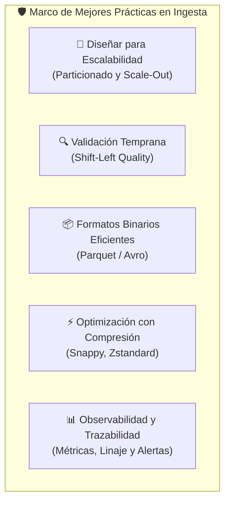

---

### 4.1 Diseño para la Escalabilidad Horizontal (Scale-Out)

- **Sin Estado (*Stateless*):** Los nodos y microservicios de ingesta no deben almacenar estado local; cualquier estado operativo se delega a sistemas distribuidos compartidos (ej. *offsets* almacenados en Kafka o almacenamiento en memoria en Redis).
- **Particionado de Datos:** División lógica de los flujos de eventos mediante claves de partición (*Partition Keys*), garantizando distribución homogénea entre los nodos del clúster y preservando el orden estricto únicamente dentro de cada partición.

---

### 4.2 Validación Temprana y Calidad del Dato (Shift-Left Quality)

El principio de **Shift-Left Data Quality** establece que la detección y contención de datos corruptos, incompletos o maliciosos debe ocurrir en el momento exacto de la ingesta, antes de que lleguen al Data Lake.

- **Filtrado y Cuarentena:** Los registros que no satisfagan las restricciones de esquema (*Schema Validation*) se dirigen a una cola de mensajes no procesados (**Dead-Letter Queue - DLQ**) para auditoría manual o reintento asistido.
- **Contratos de Datos (*Data Contracts*):** Acuerdos formales entre los equipos emisores y receptores que estipulan tipados, rangos válidos y niveles de servicio (SLA).

#### Ejemplo Práctico en Python: Validación Estricta con Pydantic y Desvío a DLQ

```python
from pydantic import BaseModel, ValidationError, Field
from typing import Optional, List

class TransaccionValida(BaseModel):
    transaccion_id: str
    cliente_id: str
    importe: float = Field(gt=0, description="El importe debe ser estrictamente positivo")
    moneda: str = Field(pattern=r"^[A-Z]{3}$", description="Código ISO de tres letras")

def procesar_lote_ingesta(eventos_crudos: List[dict]):
    almacen_data_lake = []
    dead_letter_queue = []

    for evento in eventos_crudos:
        try:
            # Validación automática contra el esquema
            registro = TransaccionValida(**evento)
            almacen_data_lake.append(registro.model_dump())
        except ValidationError as err:
            # Captura de anomalías en el punto de ingesta
            dead_letter_queue.append({
                "evento_invalido": evento,
                "motivo_fallo": err.errors()
            })

    print(f"✅ Registros válidos ingresados al Data Lake: {len(almacen_data_lake)}")
    print(f"❌ Registros desviados a Dead-Letter Queue (DLQ): {len(dead_letter_queue)}")
    if dead_letter_queue:
        print(f"   Detalle del error en DLQ: {dead_letter_queue[0]['motivo_fallo'][0]['msg']}")

if __name__ == "__main__":
    eventos = [
        {"transaccion_id": "T01", "cliente_id": "CLI_A", "importe": 99.50, "moneda": "EUR"},
        {"transaccion_id": "T02", "cliente_id": "CLI_B", "importe": -12.00, "moneda": "USD"},  # Importe negativo
        {"transaccion_id": "T03", "cliente_id": "CLI_C", "importe": 450.00, "moneda": "EUROPE"} # Moneda inválida
    ]
    procesar_lote_ingesta(eventos)
```

---

### 4.3 Formatos de Serialización Eficientes: Parquet vs. Avro

En el almacenamiento masivo, el uso de texto plano (CSV o JSON) genera penalizaciones severas en coste de almacenamiento y tiempo de consulta. Se utilizan formatos binarios tipados con esquemas integrados:

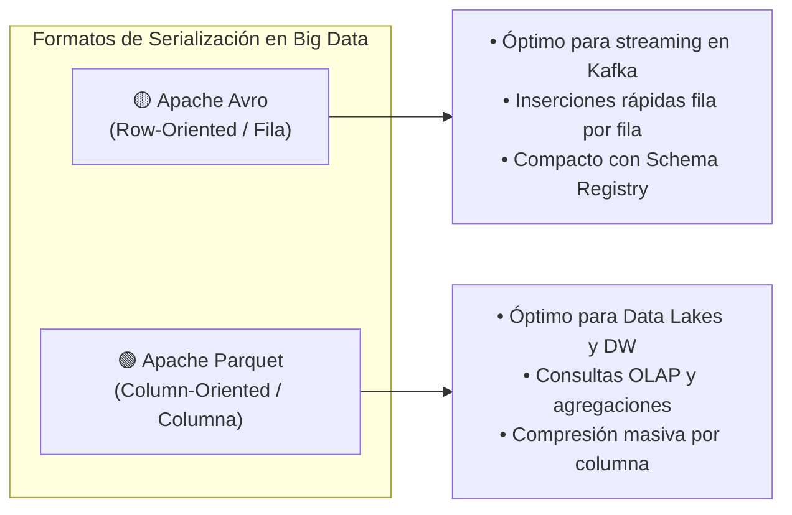

| Criterio | Apache Avro | Apache Parquet |
| :--- | :--- | :--- |
| **Disposición en Disco** | **Por Filas (*Row-based*):** Los campos contiguos de un mismo registro se almacenan juntos. | **Por Columnas (*Columnar*):** Todos los valores de una misma columna se almacenan consecutivamente en bloques. |
| **Caso de Uso Óptimo** | Ingesta continua en streaming (Apache Kafka, Event Hubs) y serialización de mensajes en tránsito. | Almacenamiento masivo analítico (Data Lakes, Hive, Snowflake, Databricks, Athena). |
| **Eficiencia de Escritura** | Muy alta y con baja latencia; ideal para *appends* continuos. | Mayor coste de computación para comprimir y crear índices por bloque. |
| **Eficiencia de Lectura** | Ideal para recuperar registros completos por clave primaria. | Excepcional para consultas selectivas (ej. `SELECT AVG(precio) WHERE fecha = '2026-10-14'`). |
| **Evolución de Esquema** | Excelente; gestionado eficientemente mediante Schema Registry. | Soporta adición y eliminación de columnas opcionales. |

#### Demostración Práctica en Python: Comparativa de Almacenamiento (CSV vs. Parquet)

```python
import pandas as pd
import numpy as np
import os

def benchmark_formatos():
    # Creación de un conjunto de datos masivo simulado (100.000 filas)
    np.random.seed(42)
    n_filas = 100_000
    df = pd.DataFrame({
        "transaccion_id": np.arange(n_filas),
        "cliente_id": np.random.choice([f"CLI_{i:04d}" for i in range(500)], size=n_filas),
        "categoria": np.random.choice(["Electrónica", "Moda", "Hogar", "Alimentación"], size=n_filas),
        "importe": np.random.uniform(5.0, 1500.0, size=n_filas).round(2),
        "fecha": pd.date_range("2026-01-01", periods=n_filas, freq="min")
    })

    ruta_csv = "dataset_temp.csv"
    ruta_parquet = "dataset_temp.parquet"

    # Guardado en disco
    df.to_csv(ruta_csv, index=False)
    df.to_parquet(ruta_parquet, engine="pyarrow", compression="snappy")

    tam_csv = os.path.getsize(ruta_csv) / (1024 * 1024)
    tam_parquet = os.path.getsize(ruta_parquet) / (1024 * 1024)

    print("--- BENCHMARK FORMATOS DE ALMACENAMIENTO (100.000 REGISTROS) ---")
    print(f"Tamaño en texto plano CSV:   {tam_csv:.2f} MB")
    print(f"Tamaño columnar Parquet:     {tam_parquet:.2f} MB")
    print(f"Ahorro de espacio en disco:  {((tam_csv - tam_parquet) / tam_csv) * 100:.1f} %")

    # Limpieza
    if os.path.exists(ruta_csv): os.remove(ruta_csv)
    if os.path.exists(ruta_parquet): os.remove(ruta_parquet)

if __name__ == "__main__":
    benchmark_formatos()
```

---

### 4.4 Optimización mediante Compresión

Los algoritmos de compresión reducen la huella física en disco y el tráfico de red:
- **Snappy:** Diseñado para priorizar la velocidad de compresión y descompresión con uso moderado de CPU; estándar en Parquet y Kafka.
- **Zstandard (zstd):** Excelente balance entre ratio de compresión ultra elevado y rendimiento en descompresión.
- **GZIP:** Alto ratio de compresión pero elevado consumo de ciclos de reloj de CPU; adecuado para archivado pasivo (*Cold Storage*).

---

### 4.5 Monitoreo, Alertas y Linaje del Dato

La observabilidad en los pipelines de ingesta se fundamenta en tres indicadores clave:
1. **Retraso del Consumidor (*Consumer Lag*):** Número de mensajes pendientes de consumir entre el último offset publicado por el productor y el último offset procesado por el consumidor. Un incremento progresivo del lag alerta sobre la necesidad de escalar consumidores horizontalmente.
2. **Latencia Extremo a Extremo (*End-to-End Latency*):** Tiempo transcurrido desde la generación del evento en el cliente hasta su disponibilidad efectiva en el almacén de consulta.
3. **Trazabilidad y Linaje:** Registro exhaustivo de la procedencia, transformaciones aplicadas y destinos de cada conjunto de datos mediante herramientas como Apache Atlas u OpenLineage.

---

## 5. Caso de Uso: Ingesta en Plataforma de E-Commerce a Gran Escala

### 5.1 Escenario y Desafíos de Negocio

Consideremos una plataforma de comercio electrónico de cobertura global que opera con millones de usuarios simultáneos:
- **Volumen:** Decenas de millones de interacciones diarias.
- **Diversidad de Fuentes:**
  1. *Transacciones financieras y pedidos:* Eventos críticos de compra.
  2. *Clickstream (Navegación web y móvil):* Clics, scroll, impresiones de banners y búsquedas.
  3. *Actualizaciones de inventario de almacén:* Stocks físicos en tiempo real.
  4. *Datos de campañas de marketing y CRM:* Métricas publicitarias consolidadas.
- **Reto de Negocio:** Sincronizar simultáneamente la detección de fraude en milisegundos, el cálculo de recomendaciones personalizadas en tiempo real y el análisis de rentabilidad diario.

---

### 5.2 Diseño de la Solución Híbrida

La solución adopta una **arquitectura híbrida (Lambda/Kappa)** articulada sobre un bus de mensajería distribuido centralizado:

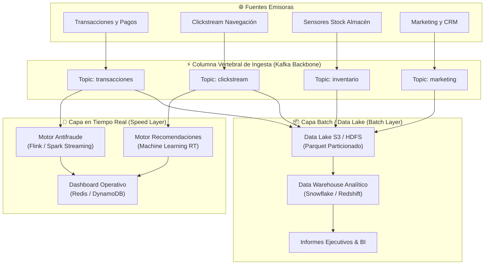

---

### 5.3 Implementación Práctica en Python

El siguiente script en Python simula el pipeline unificado del e-commerce: enruta transacciones hacia la detección inmediata de fraude (tiempo real) y almacena concurrentemente todos los registros en lotes columnares particionados:

```python
import time
import random
import pandas as pd

class PipelineEcommerce:
    def __init__(self):
        self.buffer_data_lake = []
        self.historial_fraude = []

    def ingestar_evento_compra(self, pedido_id, cliente_id, importe, ip_origen, es_internacional):
        """Punto de ingesta centralizado del evento de compra."""
        evento = {
            "pedido_id": pedido_id,
            "cliente_id": cliente_id,
            "importe": importe,
            "ip_origen": ip_origen,
            "es_internacional": es_internacional,
            "timestamp": time.time()
        }

        # 1. Ruta Rápida (Speed Layer): Detección de Fraude en Tiempo Real
        self._analizar_fraude_rt(evento)

        # 2. Ruta Lenta (Batch Layer): Acumulación para Data Lake
        self.buffer_data_lake.append(evento)

    def _analizar_fraude_rt(self, evento):
        # Regla de negocio de baja latencia: Operaciones > 1000€ internacionales son de alto riesgo
        if evento["importe"] > 1000.0 and evento["es_internacional"]:
            self.historial_fraude.append(evento)
            print(f"🚨 [MOTOR FRAUDE RT] Bloqueo preventivo Pedido {evento['pedido_id']} | Importe: {evento['importe']}€ (IP: {evento['ip_origen']})")
        else:
            print(f"⚡ [SPEED LAYER] Transacción aprobada: {evento['pedido_id']} ({evento['importe']}€)")

    def volcar_data_lake_batch(self):
        """Cierre de lote y persistencia columnar estructurada."""
        if not self.buffer_data_lake:
            return
        
        df = pd.DataFrame(self.buffer_data_lake)
        print(f"\n📦 [DATA LAKE BATCH] Persistiendo lote de {len(df)} eventos en almacenamiento columnar...")
        print(df[["pedido_id", "cliente_id", "importe", "es_internacional"]].head())
        self.buffer_data_lake.clear()

if __name__ == "__main__":
    pipeline = PipelineEcommerce()
    
    # Simulación de tráfico de compras concurrentes
    transacciones_ejemplo = [
        ("ORD_1001", "USR_88", 45.0,  "192.168.1.10", False),
        ("ORD_1002", "USR_12", 1250.0, "85.214.12.44", True),   # Alerta fraude
        ("ORD_1003", "USR_99", 89.9,  "192.168.1.15", False),
        ("ORD_1004", "USR_04", 3200.0, "194.67.21.05", True)   # Alerta fraude
    ]

    for tx in transacciones_ejemplo:
        pipeline.ingestar_evento_compra(*tx)
        time.sleep(0.1)

    # Vuelco programado batch hacia el Data Lake
    pipeline.volcar_data_lake_batch()
```

---

## 6. Arquitecturas Cloud Escalables de Ingesta (Referencia AWS)

Las implementaciones corporativas modernas trasladan estos patrones hacia plataformas de nube administradas que proporcionan elasticidad automática, tolerancia a fallos multizona y alta disponibilidad.

### 6.1 Desglose por Capas y Servicios AWS

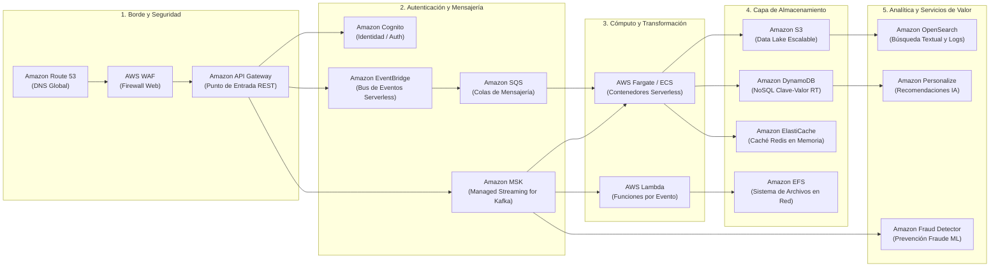

---

### 6.2 Justificación de los Componentes Arquitectónicos

1. **Capa de Borde (*Edge & Security*):**
   - **Route 53:** Distribución de tráfico con baja latencia y conmutación por error (*failover*).
   - **AWS WAF:** Inspección de paquetes entrantes y protección frente a ataques DDoS y bots maliciosos.
   - **API Gateway:** Enrutamiento de peticiones HTTPS con gestión de cuotas y autenticación federada con **Amazon Cognito**.

2. **Capa de Ingesta y Mensajería Desacoplada:**
   - **Amazon EventBridge:** Bus serverless que recibe eventos de múltiples microservicios y servicios SaaS.
   - **Amazon SQS:** Colas de amortiguación para tareas asíncronas independientes.
   - **Amazon MSK (Managed Streaming for Apache Kafka):** Backbone distribuido con particionado para flujos de millones de eventos concurrentes por segundo.

3. **Capa de Cómputo Elástico:**
   - **AWS Fargate:** Ejecución de contenedores Docker de procesamiento continuo sin gestionar servidores físicos.
   - **AWS Lambda:** Ejecución reactiva de funciones guiadas por eventos con autoescalado instantáneo de cero al infinito.

4. **Capa de Almacenamiento Especializado:**
   - **Amazon S3:** Repositorio central de objetos con durabilidad de once nueves ($99.999999999\%$), sirviendo como Data Lake primario en formatos Parquet/Avro.
   - **Amazon DynamoDB:** Base de datos NoSQL con latencias de lectura/escritura de un solo dígito de milisegundo para perfiles y carritos de compra.
   - **Amazon ElastiCache (Redis):** Caché ultrarrápida en memoria para reducir la carga sobre la base de datos primaria.
   - **Amazon EFS:** Sistema de ficheros elástico compartido accesible por múltiples instancias y contenedores concurrentes.

5. **Servicios de Analítica e Inteligencia Artificial:**
   - **Amazon OpenSearch Service:** Indexación y analítica de registros operacionales y búsqueda en catálogo.
   - **Amazon Personalize & Fraud Detector:** Algoritmos de Machine Learning gestionados que consumen el flujo de eventos de MSK para emitir predicciones en tiempo real.

---

## 7. Resumen de la Unidad, Conclusiones y Bibliografía

### 7.1 Conclusiones Principales

1. **La ingesta es el cimiento de Big Data:** La calidad, disponibilidad y velocidad de los datos explotados en analítica avanzada depende directamente de la solidez arquitectónica en la capa de ingesta.
2. **Coexistencia de patrones:** No existe un método único universal. Las arquitecturas empresariales maduras adoptan modelos híbridos (*Lambda* o *Kappa*), combinando streaming continuo para casos sensibles a la latencia y batch para análisis masivos acumulativos.
3. **El desacoplamiento es innegociable:** El uso de colas y brokers de mensajería (FIFO, Kafka, SQS) previene cuellos de botella y confiere elasticidad ante sobrecargas repentinas.
4. **Eficiencia en la serialización:** La transición de formatos de texto plano (CSV/JSON) a estándares binarios y columnares (Parquet, Avro) con compresión eficiente es imperativa para optimizar costes de red y almacenamiento.
5. **Gobernanza temprana (*Shift-Left*):** La validación y desvío de datos anómalos a Dead-Letter Queues (DLQ) protege la integridad del Data Lake y previene la degradación en un *Data Swamp*.

---

### 7.2 Bibliografía y Recursos Recomendados

- **Kleppmann, Martin (2017).** *Designing Data-Intensive Applications: The Big Ideas Behind Reliable, Scalable, and Maintainable Systems*. O'Reilly Media.  
  > 💡 Obra de referencia fundamental sobre modelos de almacenamiento, consistencia, colas de mensajería y procesamiento batch y streaming.
- **Marz, Nathan & James, Warren (2015).** *Big Data: Principles and Best Practices of Scalable Realtime Data Systems*. Manning Publications.  
  > 💡 Texto pionero que formalizó la Arquitectura Lambda y el desacoplamiento de capas en sistemas de datos masivos.
- **Kreps, Jay (2014).** *Questioning the Lambda Architecture*. O'Reilly Radar.  
  > 💡 Planteamiento fundacional de la Arquitectura Kappa y el procesamiento basado exclusivamente en streaming distribuido.
- **Recursos Web y Publicaciones Especializadas:**
  - *Towards Data Science* (Medium) — Artículos técnicos sobre pipelines de ingeniería de datos y casos de uso en producción.
  - *Data Engineering Weekly Newsletter* — Publicación periódica sobre novedades del ecosistema open-source y cloud para Big Data.
